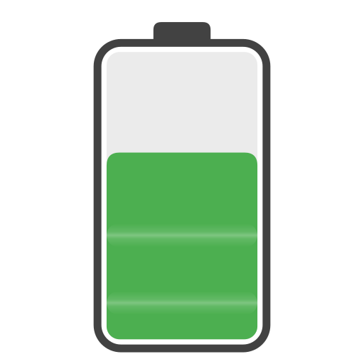

# Battery Flow Card


A custom Lovelace card for Home Assistant that provides a clear overview of
battery storage systems, charging and discharging power, and SOC limits.

## Installation

### HACS (recommended)

[](https://my.home-assistant.io/redirect/hacs_repository/?owner=Bhomas86&repository=battery-flow-card)

The easiest way to install and update the **Battery Flow Card** is through [HACS](https://hacs.xyz/).

1. Open **HACS** in Home Assistant.
2. Search for **Battery Flow Card**.
3. Open the entry and select **Download**.
4. Reload Home Assistant or your browser after installation.

HACS normally adds the required Lovelace resource automatically. If this does not happen, it can be added manually under  
**Settings → Dashboards → ⋮ → Resources**:

```text
/hacsfiles/battery-flow-card/battery-flow-card.js
```

Resource type:

```text
JavaScript Module
```

### Manual installation

1. Download `battery-flow-card.js` from the latest [GitHub Release](https://github.com/Bhomas86/battery-flow-card/releases/latest).
2. Copy the file, for example, to:

   ```text
   /config/www/battery-flow-card/battery-flow-card.js
   ```

3. Open in Home Assistant:

   **Settings → Dashboards → ⋮ → Resources**

4. Add a new resource:

   ```text
   /local/battery-flow-card/battery-flow-card.js
   ```

5. Select the resource type:

   ```text
   JavaScript Module
   ```

6. Reload the browser completely afterwards, if necessary using `Ctrl + F5`.

The card can then be added through the visual card editor or configured using YAML:

```yaml
type: custom:battery-flow-card
```

## Preview


## Features

- Displays the current SOC
- Animated charging and discharging indicator
- Displays the current battery capacity
- Displays the current charging or discharging power
- Min./max. SOC markers
- Estimated time until the configured SOC limit is reached
- Power indicator relative to the maximum charging/discharging power
- Responsive layout for desktop, tablet, and smartphone
- Graphical configuration directly through the Home Assistant card editor
- Supports a single bidirectional power entity
- Supports separate charging and discharging entities
- Supports fixed or entity-based SOC and power limits
- Automatic detection for supported battery integrations (currently Battery Simulator)
- Tap SOC, stored energy and battery power values to open Home Assistant entity details
- Open the Battery Simulator device page by tapping the card title
- Enable or disable entity and device links in the graphical card editor
- Multilingual interface

## Languages

The card language automatically follows the currently configured system language in Home Assistant.

If no translation is available for the selected language, English is used automatically as the card language.

The following translations are currently available:

- German
- English
- Dutch
- French
- Polish
- Spanish
- Italian
- Swedish
- Portuguese
- Norwegian

Additional languages are welcome.

Simply open a GitHub Issue and include the following information:

- Language code, e.g. `EN` for English or `DE` for German
- Translations for the following terms:
  - Charging
  - Discharging
  - Idle
  - Max. charge
  - Max. discharge
  - Current capacity
  - Current power
  - Estimated time
  - Estimated time to
  - Target reached

## Configuration options

The card can be configured entirely through the graphical Home Assistant card editor.

Two configuration options are available:

### Automatic detection

Battery Flow Card supports automatic detection of battery storage systems through the Home Assistant device selector.

For supported integrations, users can select their battery device directly in the graphical card editor. The required entities and available SOC and power limits are then detected and assigned automatically.

**Currently supported integrations:**

| Battery system | Home Assistant integration |
|---|---|
| Battery Simulator | [hif2k1/battery_sim](https://github.com/hif2k1/battery_sim) |

Support for additional battery systems is planned.

**Is your battery system not listed yet?**

You can help expand automatic detection by sharing information about your battery system and its Home Assistant integration.

Find out what information is needed in [Help expand automatic detection](#help-expand-automatic-detection).

### Other batteries

For other battery storage systems, the required entities and limits can be assigned manually through the graphical editor.

#### Power

Two options are available for the current battery power:

- **Bidirectional power entity**  
  A single entity contains both charging and discharging power.

  The following convention applies:

  - Positive value = charging
  - Negative value = discharging

- **Separate charging/discharging entities**  
  One entity is used for charging power and another for discharging power.

Use **Use split power entities** to switch between the two options. Fields that are not required are hidden automatically.

#### SOC limits

The minimum and maximum SOC limits can be configured in two ways:

- **Fixed values**  
  Minimum and maximum are entered directly as percentages.

- **SOC limit entities**  
  Minimum and maximum are read from Home Assistant entities.

Use **Use SOC limit entities** to switch between the two options.

#### Power limits

The maximum charging and discharging power can also be configured in two ways:

- **Fixed values**  
  Maximum charging and discharging power are entered directly.

- **Power limit entities**  
  The values are read from Home Assistant entities.

Important: The maximum charging and discharging power values must always be specified as positive values.

Use **Use power limit entities** to switch between the two options.

## Manual configuration

Alternatively, the card can be configured universally with any Home Assistant entities.

Example using separate charging and discharging entities together with entity-based limits:

```yaml
type: custom:battery-flow-card
name: Batteriespeicher

soc_entity: sensor.battery_soc

use_split_power_entities: true
charging_power_entity: sensor.battery_charging_power
discharging_power_entity: sensor.battery_discharging_power

capacity_kwh: 7

use_soc_limit_entities: true
min_soc_entity: number.battery_min_soc
max_soc_entity: number.battery_max_soc

use_power_limit_entities: true
max_charge_power_entity: number.battery_max_charge_power
max_discharge_power_entity: number.battery_max_discharge_power
```

Example for a Battery Simulator device:

```yaml
type: custom:battery-flow-card
use_battery_sim_device: true
battery_sim_device: YOUR_DEVICE_ID
```

## Help expand automatic detection

The goal is to support automatic configuration for as many battery storage systems as possible through the Home Assistant device selector, without manually assigning individual entities.

To achieve this, we need information about how different battery storage systems and their entities are represented in Home Assistant.

If you use a battery from **Anker SOLIX, Zendure, Huawei, BYD, Fronius**, or another manufacturer, your contribution would be greatly appreciated.

### What information do we need?

**1. General information**

- Battery manufacturer and model
- Home Assistant integration (name and preferably a GitHub link)
- Is the battery represented as a separate device in Home Assistant?
- Are all entities assigned to the battery device, or are some assigned to the inverter?

**2. Battery entities**

Please share the entity names and entity IDs for as many of the following values as possible:

| Value | Unit |
|---|---|
| State of Charge (SOC) | % |
| Total battery capacity | kWh |
| Current stored energy | kWh |
| Current battery power | W |
| Charging power (if separate) | W |
| Discharging power (if separate) | W |
| Minimum SOC | % |
| Maximum SOC | % |
| Maximum charging power | W |
| Maximum discharging power | W |

Depending on the manufacturer, model, and Home Assistant integration, not all listed values are provided as separate entities. For example, some systems do not expose the currently stored or usable energy in kWh, or the maximum charging and discharging power.

Some of these values can be calculated from other available data. However, maximum charging and discharging power may depend on the specific system setup. For battery storage systems from **Anker SOLIX or Zendure**, for example, power limits may vary depending on the connection type, inverter, and system configuration.

If possible, please also provide details about your **connection type and the actual charging and discharging power limits** of your system.

**You don't need to provide every value. Even partial entity information is helpful for developing automatic battery detection.**

**3. Additional information**

The power sign convention is particularly important:

- Does a positive value indicate charging or discharging?
- Does a negative value indicate charging or discharging?

If your system contains multiple battery modules, please also mention whether they appear as separate devices.

### How can you help?

You can find the entity information under **Developer Tools → States** or on the battery device page in Home Assistant.

Please share your information as text or screenshots in our [Home Assistant Community discussion](https://community.home-assistant.io/t/battery-flow-card-lovelace-card-for-battery-storage-visualization/) or submit it as a [GitHub Issue](https://github.com/Bhomas86/battery-flow-card/issues/new). If you would like to contribute an integration profile or implementation directly, you are also welcome to open a [Pull Request](https://github.com/Bhomas86/battery-flow-card/pulls).

Please remove any personal information, IP addresses, or serial numbers before sharing.

**Thank you for helping improve Battery Flow Card!**

## Development

The project uses:

- TypeScript
- Lit
- SVG
- Vite

Build:

```bash
npm install
npm run check
npm run build
```

The generated file is located at:

```text
dist/battery-flow-card.js
```

## License

This project is licensed under the MIT License.

## Support

If you like this project and would like to support further development, you can support the project through GitHub.

---

# Deutsche Version

# Battery Flow Card


Eine Custom Lovelace Card für Home Assistant zur übersichtlichen Darstellung
von Batteriespeichern, Lade- und Entladeleistung sowie SOC-Grenzen.

## Installation

### HACS (empfohlen)

[](https://my.home-assistant.io/redirect/hacs_repository/?owner=Bhomas86&repository=battery-flow-card)


Die einfachste Möglichkeit zur Installation und Aktualisierung der **Battery Flow Card** ist über [HACS](https://hacs.xyz/).

1. Öffne **HACS** in Home Assistant.
2. Suche nach **Battery Flow Card**.
3. Öffne den Eintrag und wähle **Download**.
4. Lade Home Assistant bzw. den Browser nach der Installation neu.

HACS legt die benötigte Lovelace-Ressource normalerweise automatisch an. Falls dies nicht geschieht, kann sie unter  
**Einstellungen → Dashboards → ⋮ → Ressourcen** manuell ergänzt werden:

```text
/hacsfiles/battery-flow-card/battery-flow-card.js
```

Ressourcentyp:

```text
JavaScript-Modul
```

### Manuelle Installation

1. Lade `battery-flow-card.js` aus dem neuesten [GitHub Release](https://github.com/Bhomas86/battery-flow-card/releases/latest) herunter.
2. Kopiere die Datei beispielsweise nach:

   ```text
   /config/www/battery-flow-card/battery-flow-card.js
   ```

3. Öffne in Home Assistant:

   **Einstellungen → Dashboards → ⋮ → Ressourcen**

4. Füge eine neue Ressource hinzu:

   ```text
   /local/battery-flow-card/battery-flow-card.js
   ```

5. Wähle als Typ:

   ```text
   JavaScript-Modul
   ```

6. Lade den Browser anschließend vollständig neu, gegebenenfalls mit `Strg + F5`.

Danach kann die Karte über den visuellen Karteneditor hinzugefügt oder per YAML verwendet werden:

```yaml
type: custom:battery-flow-card
```

## Vorschau


## Funktionen

- Anzeige des aktuellen SOC
- Animierte Lade- und Entladeanzeige
- Darstellung der aktuellen Batteriekapazität
- Anzeige der aktuellen Lade- bzw. Entladeleistung
- Min-/Max-SOC-Markierungen
- Geschätzte Zeit bis zum eingestellten SOC-Limit
- Leistungsanzeige relativ zur maximalen Lade-/Entladeleistung
- Responsive Darstellung für Desktop, Tablet und Smartphone
- Grafische Konfiguration direkt über den Home-Assistant-Karteneditor
- Unterstützung einer einzelnen bidirektionalen Power-Entity
- Unterstützung getrennter Lade- und Entlade-Entities
- Unterstützung fester oder Entity-basierter SOC- und Leistungsgrenzen
- Automatische Erkennung unterstützter Batteriesysteme (aktuell Battery Simulator)
- SOC, gespeicherte Energie und Batterieleistung antippen, um Entitätsdetails zu öffnen
- Geräteseite des Battery Simulators durch Antippen der Kartenüberschrift öffnen
- Entitäts- und Gerätelinks im grafischen Karteneditor aktivieren oder deaktivieren
- Mehrsprachige Oberfläche

## Sprachen

Die Sprache der Karte richtet sich automatisch nach der aktuell eingestellten Systemsprache von Home Assistant.

Ist für die verwendete Sprache noch keine Übersetzung vorhanden, wird automatisch Englisch als Kartensprache verwendet.

Aktuell stehen folgende Übersetzungen zur Verfügung:

- Deutsch
- Englisch
- Niederländisch
- Französisch
- Polnisch
- Spanisch
- Italienisch
- Schwedisch
- Portugiesisch
- Norwegisch

Weitere Sprachen können gerne ergänzt werden.

Hierzu einfach ein GitHub Issue eröffnen und folgende Angaben mitsenden:

- Sprachkürzel, z. B. `EN` für Englisch oder `DE` für Deutsch
- Übersetzungen für folgende Begriffe:
  - Charging
  - Discharging
  - Idle
  - Max. charge
  - Max. discharge
  - Current capacity
  - Current power
  - Estimated time
  - Estimated time to
  - Target reached

## Konfigurationsmöglichkeiten

Die Karte kann vollständig über den grafischen Home-Assistant-Karteneditor eingerichtet werden.

Dabei stehen zwei Möglichkeiten zur Verfügung:

### Automatische Erkennung

Die Battery Flow Card unterstützt die automatische Erkennung von Batteriesystemen über die Home-Assistant-Geräteauswahl.

Bei unterstützten Integrationen kann das Batterie-Gerät direkt im grafischen Karteneditor ausgewählt werden. Die benötigten Entitäten sowie verfügbare SOC- und Leistungsgrenzen werden anschließend automatisch erkannt und übernommen.

**Bereits unterstützte Integrationen:**

| Batteriesystem | Home-Assistant-Integration |
|---|---|
| Battery Simulator | [hif2k1/battery_sim](https://github.com/hif2k1/battery_sim) |

Weitere Batteriesysteme sollen zukünftig ergänzt werden.

**Dein Batteriesystem ist noch nicht aufgeführt?**

Wenn du die Entwicklung unterstützen möchtest, kannst du dabei helfen, weitere Batteriesysteme in die automatische Erkennung aufzunehmen.

Welche Informationen dafür benötigt werden, erfährst du unter [Hilfe bei der automatischen Erkennung](#hilfe-bei-der-automatischen-erkennung).

### Andere Batterien

Für andere Batteriespeicher können die benötigten Entities und Grenzwerte manuell über den grafischen Editor zugeordnet werden.

#### Power

Für die aktuelle Batterie-Leistung stehen zwei Varianten zur Verfügung:

- **Bidirectional power entity**  
  Eine einzelne Entity enthält sowohl die Lade- als auch die Entladeleistung.

  Dabei gilt:

  - Positiver Wert = Laden
  - Negativer Wert = Entladen

- **Separate charging/discharging entities**  
  Je eine eigene Entity für Lade- und Entladeleistung.

Über **Use split power entities** kann zwischen beiden Varianten umgeschaltet werden. Nicht benötigte Felder werden automatisch ausgeblendet.

#### SOC limits

Die minimalen und maximalen SOC-Grenzen können auf zwei Arten konfiguriert werden:

- **Feste Werte**  
  Minimum und Maximum werden direkt in Prozent eingetragen.

- **SOC limit entities**  
  Minimum und Maximum werden aus Home-Assistant-Entities gelesen.

Über **Use SOC limit entities** kann zwischen beiden Varianten umgeschaltet werden.

#### Power limits

Die maximale Lade- und Entladeleistung kann ebenfalls auf zwei Arten konfiguriert werden:

- **Feste Werte**  
  Maximale Lade- und Entladeleistung werden direkt eingetragen.

- **Power limit entities**  
  Die Werte werden aus Home-Assistant-Entities gelesen.

Wichtig: Die Werte für maximale Lade- und Entladeleistung müssen immer als positive Werte angegeben werden.

Über **Use power limit entities** kann zwischen beiden Varianten umgeschaltet werden.

## Manuelle Konfiguration

Alternativ kann die Karte universell mit beliebigen Home-Assistant-Entities
konfiguriert werden.

Beispiel mit getrennten Lade- und Entlade-Entities sowie Entity-basierten Grenzwerten:

```yaml
type: custom:battery-flow-card
name: Batteriespeicher

soc_entity: sensor.battery_soc

use_split_power_entities: true
charging_power_entity: sensor.battery_charging_power
discharging_power_entity: sensor.battery_discharging_power

capacity_kwh: 7

use_soc_limit_entities: true
min_soc_entity: number.battery_min_soc
max_soc_entity: number.battery_max_soc

use_power_limit_entities: true
max_charge_power_entity: number.battery_max_charge_power
max_discharge_power_entity: number.battery_max_discharge_power
```

Beispiel für ein Battery-Simulator-Gerät:

```yaml
type: custom:battery-flow-card
use_battery_sim_device: true
battery_sim_device: YOUR_DEVICE_ID
```

## Hilfe bei der automatischen Erkennung

Ziel ist es, zukünftig möglichst viele Batteriesysteme automatisch über die Home-Assistant-Geräteauswahl konfigurieren zu können – ohne dass die einzelnen Entitäten manuell zugeordnet werden müssen.

Dafür benötigen wir Informationen darüber, wie unterschiedliche Batteriespeicher und deren Entitäten in Home Assistant aufgebaut sind.

Wenn du beispielsweise ein Batteriesystem von **Anker SOLIX, Zendure, Huawei, BYD, Fronius** oder einem anderen Hersteller verwendest, freuen wir uns über deine Unterstützung.

### Welche Informationen benötigen wir?

**1. Allgemeine Informationen**

- Hersteller und Modell des Batteriespeichers
- Verwendete Home-Assistant-Integration (Name und möglichst GitHub-Link)
- Ist der Batteriespeicher als eigenständiges Gerät in Home Assistant angelegt?
- Sind alle Entitäten diesem Gerät zugeordnet oder teilweise dem Wechselrichter?

**2. Entitäten des Batteriesystems**

Bitte teile uns möglichst die Entitätsnamen und Entity-IDs der folgenden Werte mit:

| Wert | Einheit |
|---|---|
| Ladezustand (SOC) | % |
| Gesamtkapazität der Batterie | kWh |
| Aktuell gespeicherte Energie | kWh |
| Aktuelle Batterieleistung | W |
| Ladeleistung (falls separat vorhanden) | W |
| Entladeleistung (falls separat vorhanden) | W |
| Minimaler SOC | % |
| Maximaler SOC | % |
| Maximale Ladeleistung | W |
| Maximale Entladeleistung | W |

Je nach Hersteller, Modell und verwendeter Home-Assistant-Integration werden nicht alle aufgeführten Werte als eigene Entitäten bereitgestellt. Beispielsweise fehlen bei manchen Systemen Angaben zur aktuell gespeicherten bzw. nutzbaren Energie in kWh oder zur maximalen Lade- und Entladeleistung.

Einige dieser Werte lassen sich aus vorhandenen Daten berechnen. Insbesondere die maximalen Lade- und Entladeleistungen können jedoch vom Systemaufbau abhängen. Bei Batteriespeichern von **Anker SOLIX oder Zendure** können beispielsweise je nach Anschlussart, Wechselrichter und Konfiguration unterschiedliche Leistungsgrenzen gelten.

Bitte gib daher, soweit bekannt, auch die **Anschlussart und die tatsächlichen Leistungsgrenzen** deines Systems an.

**Nicht alle Angaben müssen vollständig sein. Auch teilweise vorhandene Entitätsinformationen helfen bei der Entwicklung der automatischen Erkennung.**

**3. Zusätzliche Informationen**

Besonders wichtig ist, welches Vorzeichen die Batterieleistung verwendet:

- Positiver Wert = Laden oder Entladen?
- Negativer Wert = Laden oder Entladen?

Falls mehrere Batteriemodule vorhanden sind, wäre außerdem interessant, ob diese als separate Geräte dargestellt werden.

### Wie kannst du helfen?

Die benötigten Entitätsinformationen findest du in Home Assistant unter **Entwicklerwerkzeuge → Zustände** oder auf der jeweiligen Geräteseite.

Teile die Informationen gerne als Text oder Screenshot in unserem [Home-Assistant-Community-Beitrag](https://community.home-assistant.io/t/battery-flow-card-lovelace-card-for-battery-storage-visualization/) oder reiche sie als [GitHub Issue](https://github.com/Bhomas86/battery-flow-card/issues/new) ein. Wenn du direkt ein Integrationsprofil oder eine Implementierung beisteuern möchtest, kannst du auch einen [Pull Request](https://github.com/Bhomas86/battery-flow-card/pulls) erstellen.

Bitte entferne vorher persönliche Daten, IP-Adressen und Seriennummern.

**Vielen Dank für deine Unterstützung bei der Weiterentwicklung der Battery Flow Card!**

## Entwicklung

Das Projekt verwendet:

- TypeScript
- Lit
- SVG
- Vite

Build:

```bash
npm install
npm run check
npm run build
```

Die erzeugte Datei befindet sich anschließend unter:

```text
dist/battery-flow-card.js
```

## Lizenz

Dieses Projekt steht unter der MIT-Lizenz.

## Unterstützung

Wenn dir das Projekt gefällt und du die weitere Entwicklung unterstützen möchtest, kannst du das Projekt über GitHub unterstützen.
